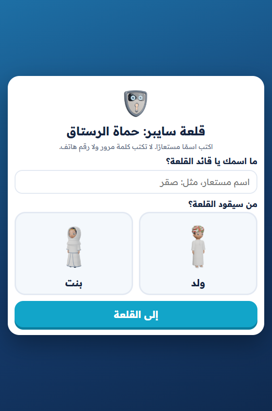
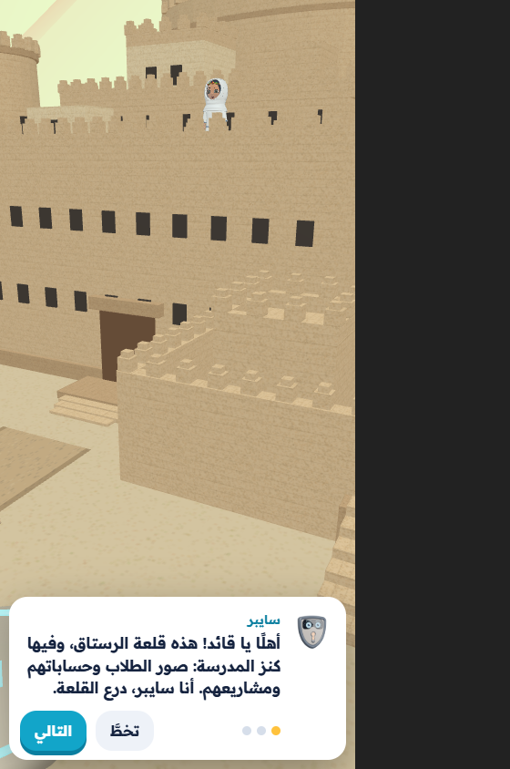
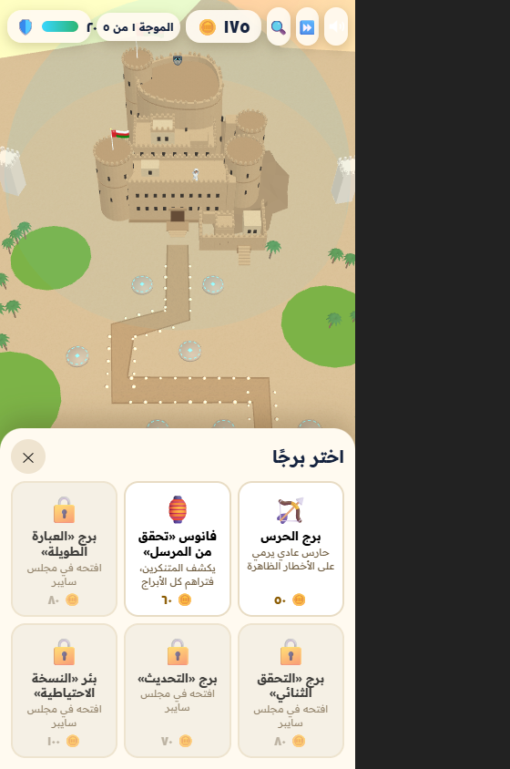
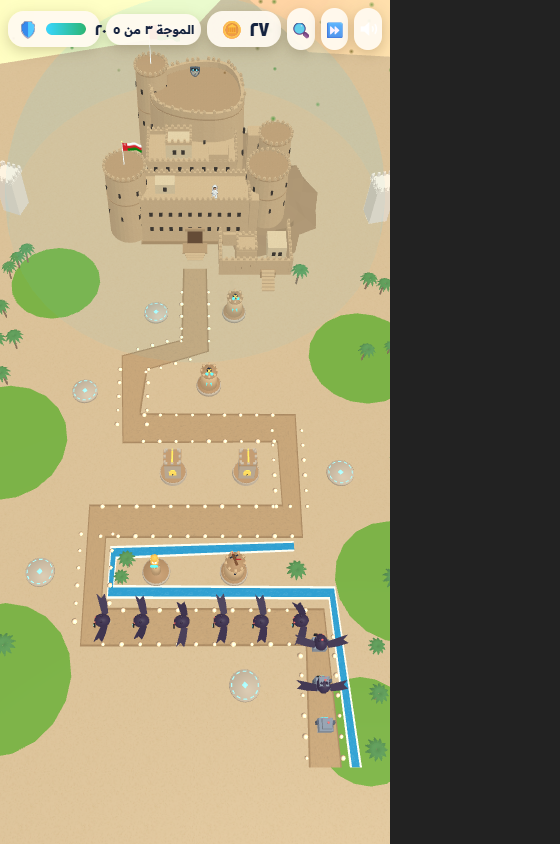
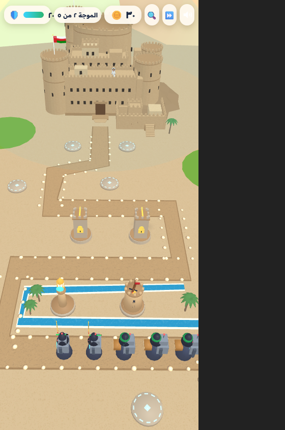
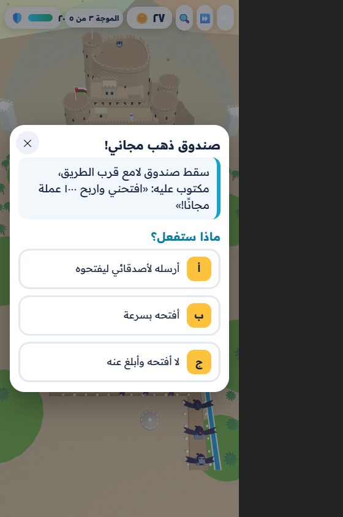
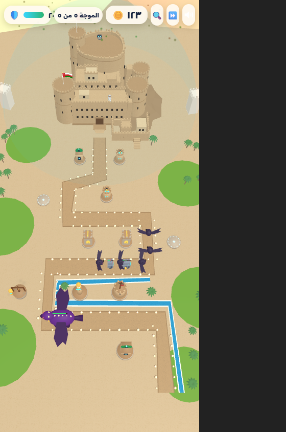
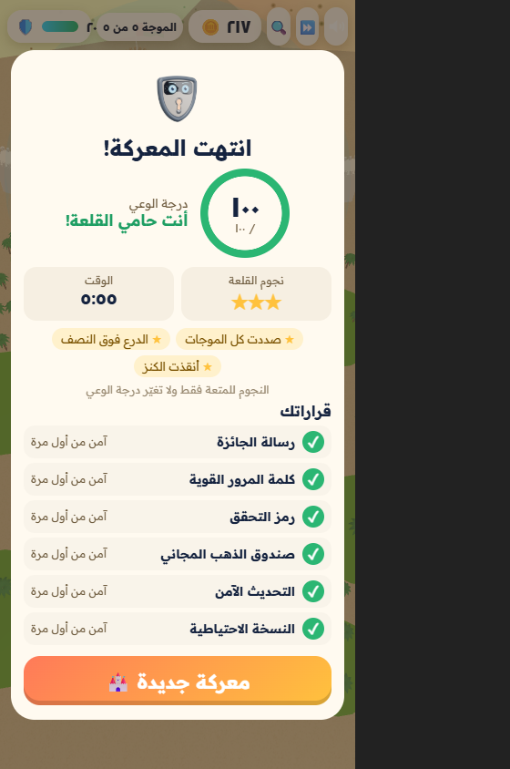

# قلعة سايبر: حماة الرستاق 🏰🛡️🇴🇲

لعبة دفاع عن القلعة ثلاثية الأبعاد للأطفال، تعلّمهم الأمن السيبراني بطبقات. القلعة هي **قلعة الرستاق** وعليها علم سلطنة عمان، والشخصيات هي الولد والبنت وسايبر. تعمل في متصفح الهاتف أو الحاسوب.

| | | |
|---|---|---|
|  |  |  |
|  |  |  |
|  |  |  |

## الفكرة
الأخطار تمشي في الوادي نحو بوابة القلعة، والطفل يبني على المنصات أبراجًا. **كل برج عادة أمان حقيقية، وكل خطر تهديد حقيقي، وكل خطر لا يوقفه إلا البرج المناسب له:**

| الخطر | البرج الذي يوقفه |
|---|---|
| 🎭 المتنكر (التصيد) | 🏮 فانوس «تحقق من المرسل» يكشفه |
| 🤖 روبوت التخمين | 🔐 برج «العبارة الطويلة» |
| 🦇 المتصل المحتال (يطلب الرمز) | 🗝️ برج «التحقق الثنائي» |
| 🐛 الدودة (التحميلات المجهولة) | ⚙️ برج «التحديث» |
| 🐉 وحش الفدية | 🪣 بئر «النسخة الاحتياطية» ينقذ الكنز |

- **مجلس سايبر:** قبل كل موجة من الموجات الخمس يُطرح قرار، والجواب الآمن يفتح البرج المناسب.
- **فخ في الموجة الثالثة:** يسقط صندوق «ذهب مجاني»؛ من يفتحه تخرج منه ديدان نحو القلعة.

## الدرجات
- **درجة الوعي من 100:** من القرارات الستة فقط، وهي التي ترصدها المنصة. النجاح من 70٪، والتصحيح بعد خطأ يحسب 60٪.
- **نجوم القلعة (للمتعة فقط):** ⭐ صد كل الموجات، ⭐ بقاء الدرع فوق النصف، ⭐ إنقاذ الكنز.
- **لا خسارة نهائية:** سايبر يعيد شحن الدرع إذا سقط، فلا يُحبَط الطفل.

## للمطورين
- **الربط مع منصة React:** [CLAUDE.md](CLAUDE.md).
- **التقييم والتحسينات:** [docs/REVIEW_AR.md](docs/REVIEW_AR.md).
- **مصادر الأصول:** [ASSETS_NOTICE.md](ASSETS_NOTICE.md).
- **التطوير:** `npm ci`، ثم `npm run dev`. وللاختبار `npm test`، وللبناء `npm run build`.

**English:** a 3D tower-defence game for children about layered cyber safety (Arabic, RTL). It is set at Rustaq Fort, Oman, and built with Vite, TypeScript and Babylon.js 8. See [CLAUDE.md](CLAUDE.md).
